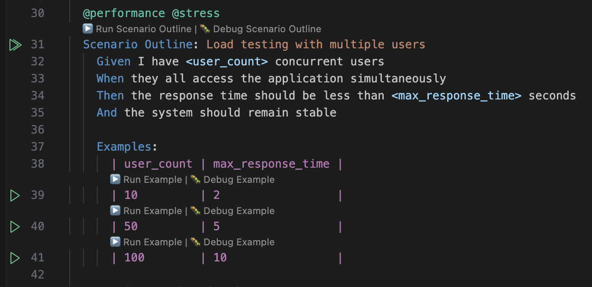
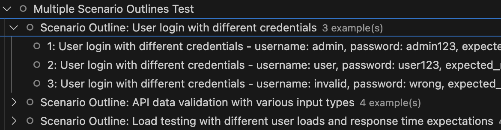
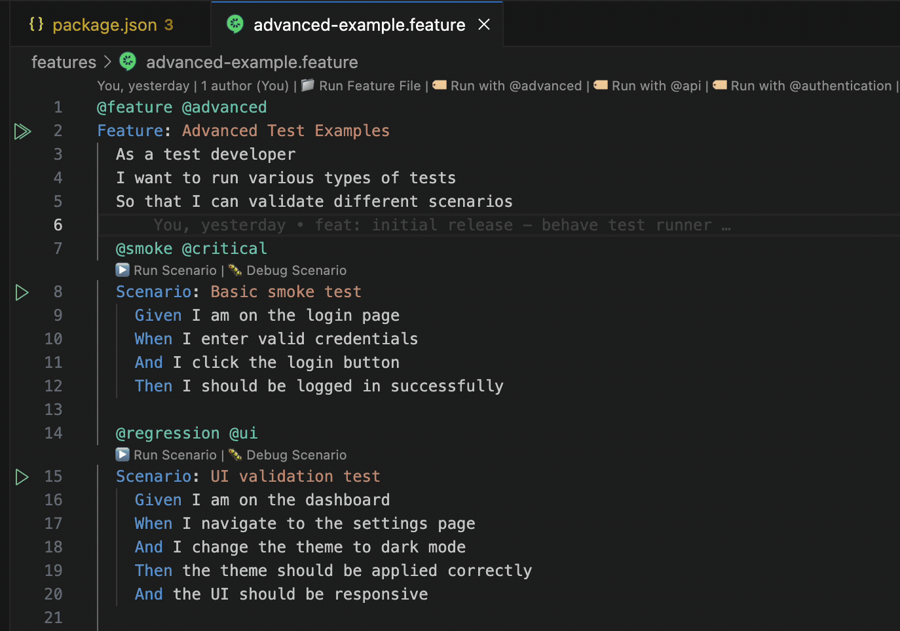
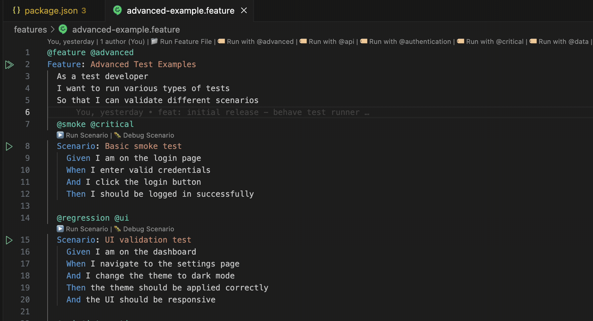
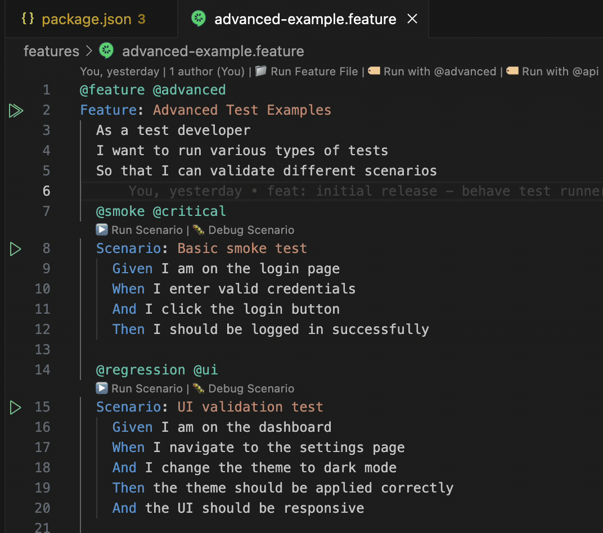

# Behave Test Runner

A VS Code extension for discovering, running, and debugging [Behave](https://behave.readthedocs.io/) and [pytest-bdd](https://pytest-bdd.readthedocs.io/) tests with full integration into the VS Code testing framework.

## Features

- 🔍 **Automatic Test Discovery**: Automatically finds and parses `.feature` files in your workspace
- ▶️ **Run Tests**: Run individual scenarios or entire feature files with a single click
- 🐛 **Debug Support**: Debug scenarios with full VS Code debugging capabilities
- 📊 **Test Explorer Integration**: View and manage tests in the VS Code Test Explorer with organized hierarchy
- 🎯 **CodeLens Support**: Run/debug scenarios directly from the editor with inline buttons
- 🏷️ **Tag-based Organization**: Automatically groups scenarios by tags for better organization
- 📋 **Scenario Outline Support**: Full support for scenario outlines with individual example tracking
- 🔢 **Smart Example Naming**: Clean, numbered examples (1:, 2:, 3:) instead of verbose names
- 📏 **Long Column Names Handling**: Intelligently truncates long table column names for readability
- ⚙️ **Configurable**: Customize behave command, working directory, and more
- 🔄 **Auto-refresh**: Automatically updates when feature files change
- 🚀 **Parallel Execution**: Run tests in parallel for faster execution
- 🤝 **Extension Compatibility**: Designed to work seamlessly with Cucumber (Gherkin) Full Support
- 🔧 **Multi-Framework Support**: Support for both Behave and pytest-bdd frameworks with automatic detection

## Installation

### From VSIX

1. Download the latest `.vsix` file from the [releases page](https://github.com/upscaled-dev/behave-vsc-extension/releases)
2. In VS Code, go to Extensions (Ctrl+Shift+X)
3. Click the "..." menu and select "Install from VSIX..."
4. Select the downloaded file

### From Source

```bash
git clone https://github.com/your-username/behave-test-runner.git
cd behave-test-runner
npm install
npm run package:vsix
```

## Usage

### Prerequisites

- Python with your preferred BDD framework installed:
  - **Behave**: `pip install behave` 
  - **pytest-bdd**: `pip install pytest-bdd`
- VS Code 1.99.0 or later

### Basic Usage

1. **Open a workspace** containing `.feature` files
2. **Framework Detection**: The extension automatically detects your BDD framework (Behave or pytest-bdd) based on configuration files
3. **Discover tests** by running the "Behave: Discover Tests" command
3. **View tests** in the Test Explorer (Ctrl+Shift+P → "Testing: Focus on Test Explorer View")
4. **Run tests** by clicking the play button next to any test
5. **Debug tests** by clicking the debug button next to any test

### Test Organization/Test View

The extension automatically organizes your tests in the Test Explorer with multiple organization strategies:

#### Default: Feature-Based (Hierarchical) Organization

The extension uses **Feature-Based (Hierarchical) Organization** as the default strategy:

- **Feature Files**: Top-level containers for your feature files
- **Scenarios**: Nested as children under their respective feature files
- **Scenario Outlines**: Special groups for scenario outlines with their examples
- **Individual Scenarios**: Regular scenarios and scenario outline examples

> **Note**: The default organization strategy is set in the extension code and cannot be changed via configuration. You can switch between strategies using the context menu in the Test Explorer.

###### Switching views


#### Alternative Organization Strategies

- **Tag-Based Organization**: Groups scenarios by their tags (e.g., `@smoke`, `@regression`)
- **File-Based Organization**: Groups scenarios by their file paths
- **Scenario Type Organization**: Groups by scenario type (regular vs outline)
- **Flat Organization**: All scenarios at the same level

**Switch Organization**: Right-click in the Test Explorer → "Organization Strategy" → Choose your preferred organization strategy

The extension provides enhanced support for scenario outlines:

- **Clean Example Names**: Examples are named as "1:", "2:", "3:" instead of "Example 1", "Example 2"
- **Long Column Name Handling**: Column names longer than 15 characters are truncated for readability
- **Multiple Outlines**: Support for multiple scenario outlines in the same feature file
- **Sorted Examples**: Examples are automatically sorted by their number
- **Organized Hierarchy**: Scenario outline examples are grouped under their parent outline

#### Extended support for scenario outline
- Execute test from scenario outline level or example

- Hierachichal view of scenario outline examples for easy navigation


### CodeLens Features

When you open a `.feature` file, you'll see inline buttons above each scenario:

- ▶️ **Run Scenario**: Runs the specific scenario
- 🐛 **Debug Scenario**: Debugs the specific scenario

#### Code lens inline buttons
- Feature inline buttons [Run Feature File]| Run with <@tags-available> | ...

- Play button on feature level will execute feature and update test explorer on test outcome

- Play button scenario level will execute an individual scenario 


> **Note**: Right click on play button will give additional options like debugging test

### Step Definition Navigation

Click on any step in a `.feature` file and press <kbd>F12</kbd> (or right-click → "Go to Definition") to jump to the matching Python `@given`/`@when`/`@then`/`@step` decorator.

Supports both styles:

- **behave**: `@given('I have {count:d} users')`
- **pytest-bdd**: `@given(parsers.parse('I enter {name}'))` and `@then(parsers.re(r'^count is (\d+)$'))`

Navigation is static and does not import or execute project code. It recognizes single-line explicit imports and aliases, plus unshadowed injected Behave decorators when the selected framework is Behave. It supports Behave `parse`, `cfparse`, and unanchored `re` after a standalone single-line literal `use_step_matcher` switch, and pytest-bdd literals plus `parsers.parse`, `parsers.cfparse`, and `parsers.re`. Multiline decorators remain supported. Supported parse fields are untyped, unnamed typed, or repeated named fields with the same `d`, `f`, or `w` type. `d` accepts signed decimal, binary, octal, and hexadecimal values; `f` accepts decimal values plus lower- or upper-case `nan` and `inf` in Behave, and pytest-bdd follows its case-insensitive parser; `w` accepts Unicode word characters. Cfparse cardinality fields and custom converters are unresolved. The supported regex subset is literal text, groups including named groups, character classes, quantifiers, dot, and ASCII-only `\\d`; pytest-bdd may use outer `^` and `$` anchors. Ordinary and raw Python string literals are decoded according to their literal form. Pytest-bdd's single literal `target_fixture=` metadata option is supported. Dynamic or reassigned imports and matcher changes, `register_type`, `re0`, other decorator options, extra positional arguments, unsupported Python regex, and outline steps without concrete Examples rows are left unresolved rather than guessed.

By default the extension searches `features/steps/**/*.py`, `tests/**/*.py`, and `tests/steps/**/*.py`. Override via `behaveTestRunner.stepDefinitionPaths`:

```jsonc
{
  "behaveTestRunner.stepDefinitionPaths": [
    "src/acceptance/steps/**/*.py",
    "tests/bdd/steps/**/*.py"
  ]
}
```

If you prefer the **Cucumber (Gherkin) Full Support** extension's navigation, disable ours to avoid duplicate results:

```jsonc
{ "behaveTestRunner.enableStepDefinitionNavigation": false }
```

### Gherkin languages

Discovery, CodeLens, Behave outline selection, and step-definition navigation use the standard Gherkin language declared by a leading `# language: <code>` header. Files without a header use English, including `Business Need:` and `Ability:` feature aliases. An unknown header is not treated as English, so correct the header before discovery can show scenarios. Runner-configured default languages are not used for discovery, so declare `# language:` in each localized feature. The bundled keyword catalog is from gherkin-official 29.0.0; see [third-party notices](THIRD-PARTY-NOTICES.md).

### Recommended companion settings (Cucumber Full Support)

This extension is designed to coexist with [Cucumber (Gherkin) Full Support](https://marketplace.visualstudio.com/items?itemName=alexkrechik.cucumberautocomplete) (auto-installed via `extensionPack`). To get its syntax highlighting and autocomplete on Python step defs, add to your workspace `.vscode/settings.json`:

```jsonc
{
  "cucumberautocomplete.steps": [
    "features/steps/**/*.py",
    "tests/**/*.py"
  ],
  "cucumberautocomplete.syncfeatures": "features/**/*.feature",
  "cucumberautocomplete.strictGherkinCompletion": true
}
```

### Commands

| Command                              | Description                                    |
| ------------------------------------ | ---------------------------------------------- |
| `Behave: Discover Tests`             | Manually discover and load test files          |
| `Behave: Refresh Tests`              | Refresh and reload all test files              |
| `Behave: Run All Tests`              | Run all tests in the workspace                 |
| `Behave: Run All Tests in Parallel`  | Run all tests in parallel for faster execution |
| `Behave: Run Scenario`               | Run a specific scenario (used by CodeLens)     |
| `Behave: Debug Scenario`             | Debug a specific scenario (used by CodeLens)   |
| `Behave: Run Feature File`           | Run an entire feature file                     |
| `Behave: Run Feature File with Tags` | Run a feature file with specific tags          |

Tests require a trusted workspace. Discovery and step navigation remain available in Restricted Mode. One run, debug operation, or parallel run can execute at a time in each extension host. Test Explorer cancellation stops the owned process group and skips unfinished selections; completed results are preserved. Deactivation waits for confirmed execution cleanup. If termination cannot be confirmed within the shutdown window, the operation ends with an error and further execution requires reloading the window. The extension retains ownership and temporary reports until termination can be confirmed; a failed Windows tree termination leaves its report for temporary-directory cleanup.

Run output streams to Test Results and the Behave Test Runner output channel. Each invocation uses a private temporary JSON report, removed after confirmed process termination. Missing, malformed, or structurally invalid reports show an execution error. Report diagnostics contain counts rather than report bodies. Runs have a 15 minute timeout, retain 256 KiB per output stream, share a 1 MiB display payload budget across streamed output and report-derived Test Results messages, with one truncation notice and fixed per-item status summaries outside that payload budget, and accept reports up to 16 MiB. Debug sessions remain open until the debugger terminates or the user cancels.

`behaveTestRunner.outputFormat` selects Behave's visible `pretty`, `plain`, `json`, `progress` or `steps` formatter. Per-call execution options override the captured project setting; the default is `pretty`. Selecting `steps` displays step definitions while still executing tests. Captured runs send the selected visible format to stdout and keep a separate private JSON formatter for Test Explorer outcomes.

`junit` enables Behave's native JUnit reporter with pretty console output. XML remains in the native `junit_directory`, or `reports` relative to the project's working directory by default. Behave owns overwrite and partial-output behavior; private report cleanup leaves this XML intact. These user artifacts are outside the in-memory report and display limits. Debug uses the same formatter and native JUnit choice while preserving native human-output destinations. Existing native reporter settings remain effective under ordinary format choices.

Native formatter destinations retain Behave's own behavior, including format-only configuration, a standalone outfile, and unmatched `-f`/`-o` flags in `behaveCommand`. Captured runs keep the private report independent of those destinations. If native configuration sends the selected format to a file, that file is retained and the same format also reaches Test Explorer output. Behave still rejects invalid native configurations such as more outfiles than formatters. Custom aliases that replace built-in formatters are outside this supported-format contract.

Command settings accept executable prefixes such as `behave`, `python -m behave`, `"/path with spaces/python" -m behave`, `poetry run behave`, or `uv run behave`. Arguments from files, tags, and scenario names are passed directly to the executable. Migrate shell aliases, environment assignments, pipes, redirects, substitutions, explicit shell hosts, and Windows `.cmd` or `.bat` shims to an executable or Python module command. Debug supports a bare framework tool with the selected Python interpreter or an explicit Python module command; wrappers are available for Run. Parallel execution supports Behave with at most 16 workers and reports failed workers through the initiating command; pytest-bdd parallel requests are rejected before launch.

Each workspace folder has its own framework, Python command, working directory, tags, dry-run, discovery pattern and worker limit. File and Test Explorer selections use the containing folder. Relative working directories resolve against that folder. Open the containing folder before running a file outside the workspace. Settings are captured for each operation; later runs use changed settings.

Run All and workspace tag commands visit all projects sequentially under one cancellation and output budget. Parallel runs process Behave projects sequentially, with up to 16 workers inside each project; a request containing pytest-bdd is rejected before any worker starts. Debugging uses the selected project's VS Code folder and configured cwd. pytest-bdd uses actual collected Python bindings, so module/function names and parameter IDs can differ from Gherkin display names. Selecting a scenario or Examples row runs every matching collected variant and combines their outcomes. Native pytest configuration is loaded from the configured cwd; feature selection collects within its project and excludes unrelated tests. Workspace suite/tag commands retain native testpaths and ordinary pytest tests. Collection-only runs report skipped outcomes.

The collection adapter supports pytest-bdd 8.x and 9.x metadata. It maps at most 10,000 nodes, reads feature inputs up to 16 MiB and retains 1 MiB of report detail. Unsupported or missing bindings fail with an error instead of guessing a Python target. Distributed pytest execution remains unsupported.

## Configuration

### Extension Settings

| Setting                                 | Default          | Description                                                                                          |
| --------------------------------------- | ---------------- | ---------------------------------------------------------------------------------------------------- |
| `behaveTestRunner.behaveCommand`        | `"behave"`       | Command to run Behave tests (auto-detects Python if needed)                                          |
| `behaveTestRunner.workingDirectory`     | `""`             | Working directory for test execution (empty = workspace root)                                        |
| `behaveTestRunner.autoDiscoverTests`    | `true`           | Automatically discover tests on startup                                                              |
| `behaveTestRunner.testFilePattern`      | `"**/*.feature"` | Glob pattern for test file discovery                                                                 |
| `behaveTestRunner.enableCodeLens`       | `true`           | Enable CodeLens buttons on feature files (disable if conflicting with other extensions)              |
| `behaveTestRunner.enableStepDefinitionNavigation` | `true` | Enable "Go to Definition" from a Gherkin step to its Python `@given`/`@when`/`@then`                |
| `behaveTestRunner.stepDefinitionPaths`  | see below        | Globs for Python files containing step definitions (used by step navigation)                         |
| `behaveTestRunner.parallelExecution`    | `false`          | Enable parallel execution of feature files                                                           |
| `behaveTestRunner.maxParallelProcesses` | `4`              | Maximum number of parallel processes for test execution                                              |
| `behaveTestRunner.outputFormat`         | `"pretty"`       | Output format for behave test results (pretty, plain, json, junit, progress, steps)                  |
| `behaveTestRunner.tags`                 | `""`             | Default tags to filter tests (e.g., '@smoke,@regression')                                            |
| `behaveTestRunner.dryRun`               | `false`          | Enable dry run mode to see what tests would be executed without running them                         |

### Intelligent Command Detection

The extension automatically detects the correct Python command for your system:

- **macOS/Linux**: Tries `python3`, `python`, then `py`
- **Windows**: Tries `py`, `python`, then `python3`
- **Fallback**: Uses `python3 -m behave` if direct `behave` command is not available

You can override this by setting a specific command in your configuration.

### Example Configuration

```json
{
  "behaveTestRunner.behaveCommand": "python3 -m behave",
  "behaveTestRunner.workingDirectory": "tests",
  "behaveTestRunner.autoDiscoverTests": true,
  "behaveTestRunner.testFilePattern": "**/features/**/*.feature",
  "behaveTestRunner.enableCodeLens": true,
  "behaveTestRunner.enableTestExplorer": true,
  "behaveTestRunner.priority": "normal",
  "behaveTestRunner.parallelExecution": false,
  "behaveTestRunner.maxParallelProcesses": 4,
  "behaveTestRunner.outputFormat": "pretty",
  "behaveTestRunner.tags": "@smoke,@regression",
  "behaveTestRunner.dryRun": false
}
```

### Example Feature Files

**Basic Scenario Outline:**

```gherkin
@feature @login
Feature: User Login

  @smoke @critical
  Scenario Outline: Login with different credentials
    Given I am on the login page
    When I enter username "<username>" and password "<password>"
    And I click the login button
    Then I should see "<expected_result>"

    Examples:
      | username | password | expected_result |
      | admin    | admin123 | dashboard       |
      | user     | user123  | dashboard       |
      | invalid  | wrong    | error message   |
```

**Multiple Scenario Outlines:**

```gherkin
@feature @api
Feature: API Testing

  @api @validation
  Scenario Outline: Data validation with various inputs
    Given I have a valid API endpoint
    When I send "<data_type>" data with value "<input_value>"
    Then the response should contain "<validation_result>"

    Examples:
      | data_type | input_value | validation_result |
      | string    | hello       | valid             |
      | number    | 42          | valid             |
      | email     | test@test   | invalid           |

  @performance @load
  Scenario Outline: Load testing with different user loads
    Given I have configured the load testing environment
    When I simulate "<concurrent_users>" concurrent users
    Then the system should handle the load successfully

    Examples:
      | concurrent_users |
      | 10               |
      | 50               |
      | 100              |
```

In the Test Explorer, these will appear as:

**Feature-Based (Hierarchical) Organization (Default):**

- **Feature: User Login**
  - **Scenario Outline: Login with different credentials**
    - **1: Login with different credentials - username: admin, password: admin123, expected_result: dashboard**
    - **2: Login with different credentials - username: user, password: user123, expected_result: dashboard**
    - **3: Login with different credentials - username: invalid, password: wrong, expected_result: error message**

**Tag-Based Organization:**

- **@smoke** (group)
  - **1: Login with different credentials - username: admin, password: admin123, expected_result: dashboard**
  - **2: Login with different credentials - username: user, password: user123, expected_result: dashboard**

## Extension Compatibility

This extension is designed to work alongside other VS Code Gherkin extensions. 

### Recommended Configuration with Cucumber (Gherkin) Full Support

**Note**: This extension is developed and tested with Cucumber (Gherkin) Full Support extension. Since you're using Cucumber (Gherkin) Full Support for syntax highlighting and autocomplete, this extension focuses on test execution and discovery. The extensions complement each other perfectly:

```json
{
  "behaveTestRunner.enableCodeLens": true,
  "behaveTestRunner.enableTestExplorer": true,
  "behaveTestRunner.priority": "low",
  "behaveTestRunner.defaultOrganizationStrategy": "FeatureBasedOrganization"
}
```

**Why this works well:**

- **Cucumber Extension**: Handles syntax highlighting, autocomplete, and Gherkin language support
- **Behave Test Runner**: Handles test discovery, execution, and Test Explorer integration
- **No Conflicts**: Each extension has its own domain of responsibility

### Extension Priority

The `priority` setting determines which extension takes precedence when multiple extensions can handle the same file type:

- **`"low"`**: Let other extensions handle `.feature` files first
- **`"normal"`**: Standard priority
- **`"high"`**: Take precedence over other extensions

### Framework Selection Best Practices

⚠️ **Important**: A project should use **only one BDD framework** (either behave or pytest-bdd) to avoid conflicts.

#### **Automatic Detection Priority**

1. **Explicit Setting**: `behaveTestRunner.framework` wins, including `"behave"`, while automatic detection is enabled. Without an explicit setting, detection examines each project's working directory

2. **Configuration Files**: Framework with configuration files takes precedence
   - `behave.ini`, `.behaverc` → behave
   - `pytest.ini` with pytest-bdd → pytest-bdd

3. **File Pattern Fallback**: When no explicit config found
   - `.feature` files + Python test files → **defaults to behave**

4. **Default**: Always behave (for backward compatibility)

#### **Conflict Prevention**

The extension will warn you if:
- ✅ **Multiple framework configs detected**: Remove unused framework configuration
- ✅ **Ambiguous file patterns**: Add explicit framework configuration
- ✅ **Mixed test files**: Choose one framework and organize accordingly

#### **Manual Override**

Always use manual selection for complex projects:

```json
{
  "behaveTestRunner.framework": "behave",           // Explicit selection
  "behaveTestRunner.autoDetectFramework": false     // Disable auto-detection
}
```

## Configuration

The extension supports various configuration options for customizing behavior:

### Framework Selection

The extension automatically detects your BDD framework, but you can also configure it manually:

```json
{
  "behaveTestRunner.framework": "behave",              // "behave" or "pytest-bdd"
  "behaveTestRunner.autoDetectFramework": true,        // Enable automatic framework detection
  "behaveTestRunner.behaveCommand": "behave",          // Command for Behave framework
  "behaveTestRunner.pytestCommand": "pytest"           // Command for pytest-bdd framework
}
```

### Pytest-bdd collection

Pytest controls which Python files it collects. Configure `python_files` and `testpaths` in your project's native pytest configuration, for example `pytest.ini`:

```ini
[pytest]
python_files = test_*.py *_test.py
testpaths = tests
```

Configuration is resolved from `behaveTestRunner.workingDirectory`. The workspace Run All command honors `testpaths`; selecting a feature or scenario searches its project for bindings using the same `python_files` rules. A command override such as `python -m pytest --override-ini=python_files=*_checks.py` in `behaveTestRunner.pytestCommand` takes precedence over the configuration file. Use this attached option form; the extension rejects standalone `key=value` command tokens. Changes apply to the next run.

`behaveTestRunner.pytestBddFilePattern` was unused and is deprecated. Remove it from VS Code settings and use native pytest configuration instead. `behaveTestRunner.testFilePattern` still controls which `.feature` files appear in Test Explorer.

### Framework Auto-Detection

When no framework setting is explicitly configured and automatic detection is enabled, the extension detects each project's framework based on:

- **Behave**: Looks for `.behaverc`, `behave.ini`, or behave configuration in `setup.cfg`/`pyproject.toml`
- **pytest-bdd**: Looks for `pytest.ini`, `pytest-bdd` in `pyproject.toml`, or pytest-bdd imports

### General Settings

```json
{
  "behaveTestRunner.workingDirectory": "",             // Working directory for tests
  "behaveTestRunner.autoDiscoverTests": true,          // Auto-discover tests on startup
  "behaveTestRunner.testFilePattern": "**/*.feature",  // Pattern for feature files
  "behaveTestRunner.enableCodeLens": true,             // Enable CodeLens buttons
  "behaveTestRunner.enableTestExplorer": true,         // Enable Test Explorer integration
  "behaveTestRunner.priority": "normal",               // Extension priority
  "behaveTestRunner.parallelExecution": false,         // Enable parallel execution
  "behaveTestRunner.maxParallelProcesses": 4,          // Max parallel processes
  "behaveTestRunner.outputFormat": "pretty",           // Output format
  "behaveTestRunner.tags": "",                         // Default tags filter
  "behaveTestRunner.dryRun": false                     // Enable dry run mode
}
```

## Project Structure

```
src/
├── core/                   # Core functionality
│   └── test-executor.ts    # Test execution logic
├── parsers/                # File parsing
│   └── feature-parser.ts   # Gherkin feature file parser
├── test-providers/         # VS Code test integration
│   └── behave-test-provider.ts
├── commands/               # VS Code commands
│   └── command-manager.ts  # Command registration and handling
├── utils/                  # Utilities
│   └── logger.ts           # Logging utility
├── types/                  # TypeScript type definitions
│   └── index.ts            # Shared interfaces and types
└── extension.ts            # Main extension entry point
```

## Development

### Prerequisites

- Node.js 20.x or later
- npm or yarn

### Setup

```bash
# Install dependencies
npm install

# Compile TypeScript
npm run compile

# Run tests
npm test

# Package extension
npm run package:vsix
```

### Development Scripts

| Script                     | Description                            |
| -------------------------- | -------------------------------------- |
| `npm run compile`          | Compile TypeScript and build extension |
| `npm run watch`            | Watch for changes and recompile        |
| `npm run lint`             | Run ESLint                             |
| `npm run lint:fix`         | Fix ESLint issues                      |
| `npm test`                 | Run all tests                          |
| `npm run package`          | Build the production bundle            |
| `npm run package:vsix`     | Build and verify dist/name-version.vsix |
| `npm run dev`              | Start development mode                 |
| `npm run test:unit`        | Run unit tests only                    |
| `npm run test:integration` | Run integration tests only             |
| `npm run test:parser`      | Run parser tests only                  |
| `npm run test:execution`   | Run execution tests only               |

### Testing

The extension includes comprehensive tests:

- **Unit Tests**: Test individual components
- **Integration Tests**: Test VS Code integration
- **Parser Tests**: Test Gherkin parsing
- **Execution Tests**: Test test execution

Run tests with:

```bash
npm test                   # Run all tests
npm run test:unit          # Run unit tests only
npm run test:integration   # Run integration tests only
npm run test:parser        # Run parser tests only
npm run test:execution     # Run execution tests only
```

## Contributing

1. Fork the repository
2. Create a feature branch (`git checkout -b feature/amazing-feature`)
3. Commit your changes (`git commit -m 'Add amazing feature'`)
4. Push to the branch (`git push origin feature/amazing-feature`)
5. Open a Pull Request

### Code Style

- Follow TypeScript best practices
- Use ESLint for code linting
- Write comprehensive tests
- Follow conventional commit messages

## Troubleshooting

### Common Issues

**Tests not discovered:**

- Ensure `.feature` files exist in your workspace
- Check the `testFilePattern` setting
- Try running "Behave: Discover Tests" manually

**Tests not running:**

- Verify your BDD framework is installed:
  - **Behave**: `behave --version`
  - **pytest-bdd**: `pytest --version` and check for pytest-bdd plugin
- Check the framework command settings (`behaveCommand` or `pytestCommand`)
- Ensure the working directory is correct
- Verify the framework auto-detection or set it manually

**Debug not working:**

- Make sure Python debugger is configured
- Check that the Python extension is installed
- Verify the debug configuration

### Logs

Enable detailed logging by opening the Output panel (View → Output) and selecting "Behave Test Runner" from the dropdown.

## License

This project is licensed under the MIT License - see the [LICENSE](LICENSE) file for details.

## Changelog

See [CHANGELOG.md](CHANGELOG.md) for a list of changes and version history.

## Support

<b>"Code, coffee, repeat. Support the cycle!</b> : If you enjoy using <b>Behave Test Runner</b>, consider contributing to fuel my coding dreams!

<a href="https://buymeacoffee.com/upscaled.dev" target="_blank"></a>


## Acknowledgments

- [Behave](https://behave.readthedocs.io/) - Python BDD framework
- [pytest-bdd](https://pytest-bdd.readthedocs.io/) - pytest plugin for BDD
- [VS Code Extension API](https://code.visualstudio.com/api) - Extension development framework
- [Gherkin](https://cucumber.io/docs/gherkin/) - BDD syntax specification
- [gherkin-official](https://github.com/cucumber/gherkin) - bundled keyword catalog
- [Cucumber (Gherkin) Full Support](https://marketplace.visualstudio.com/items?itemName=alexkrechik.cucumberautocomplete) - VS Code extension for Gherkin syntax highlighting and autocomplete
- [Freepik](https://www.freepik.com/) - Extension icon design
